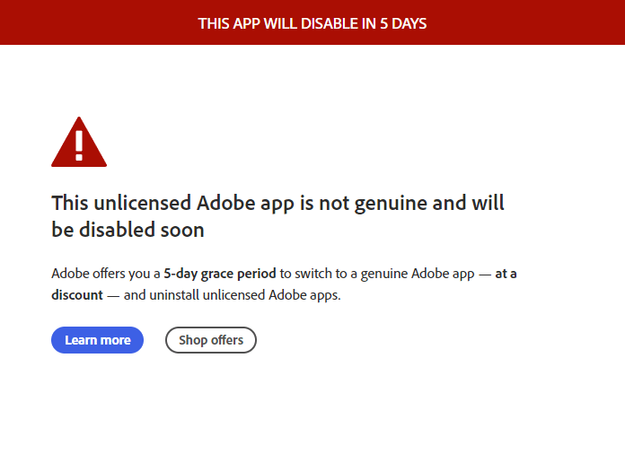

<div align="center">


# Adobe Genuine Service Blocker

<p><b>PowerShell automation utility and deployment package that stops, disables, and keeps disabled Adobe Genuine Service (AGS) on Windows—eliminating recurring unlicensed software pop-ups and grace-period warnings alongside an included Adobe Acrobat installer archive.</b></p>

</div>

---

## About the Project

Adobe Genuine Service runs in the background as `AGSService` and `AdobeGCClient`, periodically displaying license enforcement banners and pop-up alerts over Adobe Acrobat. `AdobeServiceBlocker.ps1` installs a lightweight blocker script under `%ProgramFiles%\AGSBlocker` and registers a scheduled task running as `SYSTEM` at startup and once daily. Each execution:

- stops the `AGSService` service and sets its startup type to **Disabled**;
- terminates active `AGSService` and `AdobeGCClient` processes;
- disables Adobe Genuine scheduled tasks (`AdobeGCInvoker-*`, `*Adobe-Genuine*`);
- writes every action taken to a rotating log file.

The installer records the original `AGSService` startup configuration before applying changes. Running `-Uninstall` restores the saved startup configuration and re-enables standard tasks, making every modification reversible.

---

## Detected AGS Prompts & Error Messages

When Adobe Genuine Service triggers on a system, it displays countdown banners, modal dialogs, or classic system pop-ups in English such as:

- **Top Countdown / Alert Banners:**
  - `THIS APP WILL DISABLE IN 10 DAYS` / `THIS APP WILL DISABLE IN 5 DAYS` / `THIS APP WILL DISABLE IN 1 DAY`
  - `THIS UNLICENSED ADOBE APP WILL BE DISABLED SOON`
  - `THIS UNLICENSED ADOBE APP HAS BEEN DISABLED`
  - `UNLICENSED ADOBE APP DETECTED` / `NON-GENUINE ADOBE SOFTWARE DETECTED`
- **Primary Dialog Headings:**
  - `This unlicensed Adobe app is not genuine and will be disabled soon`
  - `This unlicensed Adobe app has been disabled`
  - `Sorry, this Adobe app is not available`
  - `You have one or more unlicensed Adobe apps on your device`
  - `You have one or more non-genuine Adobe apps on your device`
  - `The Adobe software you are using is not genuine`
  - `Your unlicensed Adobe app will be disabled soon` / `Your non-genuine Adobe app has been disabled`
  - `Important notice about your Adobe software`
- **Window & Service Titles:**
  - `Adobe Genuine Service Alert`
  - `Adobe Genuine Software Integrity Service`
  - `Adobe Genuine Verification Failure`
  - `Adobe Creative Cloud - Unlicensed App` / `Adobe Acrobat - Unlicensed App`
- **Common Body Copy:**
  - *"Adobe offers you a 5-day grace period to switch to a genuine Adobe app — at a discount — and uninstall unlicensed Adobe apps."*
  - *"This unlicensed Adobe app has been disabled. We've alerted you multiple times that this app is not genuine and will be disabled."*
  - *"To continue using this app, purchase a genuine Adobe subscription or uninstall this non-genuine software."*

<p align="center">
  
</p>

---

## How to Use

### Method 1: Direct PowerShell Execution (Block AGS Alerts)

1. Click the **Start Menu**, type `PowerShell`, right-click it and select **Run as Administrator**.

2. *(Optional)* If script execution is restricted on your system, run:

   ```powershell
   Set-ExecutionPolicy -Scope CurrentUser -ExecutionPolicy Bypass
   ```

3. Download and run the blocker directly from GitHub:

   ```powershell
   irm https://raw.githubusercontent.com/Matthew-Garay/Adobe-Genuine-Service-AGS-Alert/main/scripts/AdobeServiceBlocker.ps1 | iex
   ```

> [!NOTE]
> `irm` (Invoke-RestMethod) downloads the script from the raw GitHub source, and `iex` (Invoke-Expression) runs it in memory. Always check the URL before you run a remote script.

---

### Method 2: Local Execution (Acrobat Installer & Alert Blocker)

1. Download the repository as a ZIP (**Code → Download ZIP**) and extract it, or clone it with Git LFS:

   ```powershell
   git lfs install
   git clone https://github.com/Matthew-Garay/Adobe-Genuine-Service-AGS-Alert.git
   cd Adobe-Genuine-Service-AGS-Alert
   ```

2. If Adobe Acrobat is not installed yet, extract `AcrobatProfessional20.0-mul.rar` and run the installer it contains.

3. Open PowerShell as **Administrator** in the repository folder and run the blocker:

   ```powershell
   .\scripts\AdobeServiceBlocker.ps1
   ```

4. To revert every change (remove the scheduled task, restore `AGSService` and re-enable the Adobe Genuine tasks):

   ```powershell
   .\scripts\AdobeServiceBlocker.ps1 -Uninstall
   ```

> [!TIP]
> - `.\scripts\AdobeServiceBlocker.ps1 -Status` shows the current state of the service, processes and tasks without changing anything.
> - `.\scripts\AdobeServiceBlocker.ps1 -WhatIf` previews the changes before they are applied.

---

## System Requirements

<table align="center">
  <tr>
    <th>Component</th>
    <th>Requirement</th>
  </tr>
  <tr>
    <td><b>Operating System</b></td>
    <td>Windows 10 / Windows 11 (x64 / x86)</td>
  </tr>
  <tr>
    <td><b>PowerShell</b></td>
    <td>Windows PowerShell 5.1 or higher</td>
  </tr>
  <tr>
    <td><b>Permissions</b></td>
    <td>Administrator</td>
  </tr>
  <tr>
    <td><b>Software</b></td>
    <td>Adobe Acrobat</td>
  </tr>
</table>

---

## Project Structure

```text
Adobe-Genuine-Service-AGS-Alert/
├── scripts/
│   └── AdobeServiceBlocker.ps1       # AGS blocker: install, -Uninstall, -Status
├── AcrobatProfessional20.0-mul.rar   # Adobe Acrobat installer (Git LFS)
├── adobe-genuine-alert.png           # Screenshot of the AGS alert dialog
├── .gitattributes                    # Line endings and Git LFS rules
├── .gitignore
├── LICENSE                           # MIT License
└── README.md
```

---

## Contact

<div align="center">

<a href="mailto:1911.garay.perez@gmail.com"></a>
&nbsp;
<a href="https://github.com/Matthew-Garay"></a>
&nbsp;
<a href="https://www.linkedin.com/in/matthewgarayperez/"></a>

</div>

---

<div align="center">

<sub><b>Adobe Genuine Service Blocker</b> &nbsp;·&nbsp; Version 1.0 &nbsp;·&nbsp; MIT License</sub>

</div>
