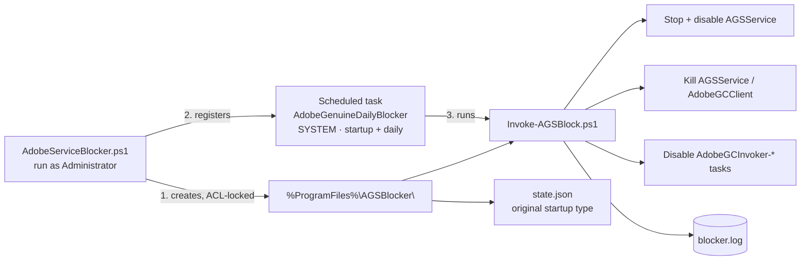

<div align="center">


# AGS Blocker

**Stop, disable and keep disabled Adobe Genuine Service (AGS) on Windows — with one PowerShell command, fully reversible.**

[](https://github.com/Matthew-Garay/Adobe-Genuine-Service-AGS-Alert/releases)
[](https://learn.microsoft.com/powershell/)
[](#system-requirements)
[](LICENSE)

</div>

<p align="center">
  
</p>

---

## Table of Contents

- [About](#about)
- [Features](#features)
- [System Requirements](#system-requirements)
- [How to Install](#how-to-install)
- [Usage](#usage)
- [How It Works](#how-it-works)
- [Uninstall / Revert](#uninstall--revert)
- [Troubleshooting](#troubleshooting)
- [Project Structure](#project-structure)
- [Legal Notice](#legal-notice)
- [License](#license)
- [Author & Contact](#author--contact)

## About

**Adobe Genuine Service (AGS)** is a background component that Adobe installs alongside Acrobat and Creative Cloud apps. It runs the `AGSService` Windows service, the `AdobeGCClient` process and the `AdobeGCInvoker-1.0` scheduled task, and periodically validates the installed software.

On correctly licensed machines AGS is known to raise **false "non-genuine software" alerts** — for example after a hardware change, on offline or air-gapped workstations, or on volume-licensed images. AGS also re-enables itself on updates, so turning the service off once is not enough.

**AGS Blocker** solves this with a small, auditable PowerShell tool that:

1. stops and disables the AGS service, processes and scheduled tasks, and
2. installs a protected scheduled task that keeps them disabled across reboots and Adobe updates,
3. while saving the original state so **every change can be reverted with `-Uninstall`**.

> [!IMPORTANT]
> This tool does **not** install, crack, patch or activate any Adobe software, and it does not distribute Adobe binaries. You still need a valid Adobe license. See [Legal Notice](#legal-notice).

## Features

| | Feature | Details |
|---|---|---|
| 🛑 | **Service control** | Stops `AGSService` and sets its startup type to `Disabled`. |
| ⚙️ | **Process cleanup** | Terminates `AGSService` and `AdobeGCClient`. |
| 🗓️ | **Task cleanup** | Disables `AdobeGCInvoker-*` and `*Adobe-Genuine*` scheduled tasks. |
| 🔁 | **Persistence** | Scheduled task runs as SYSTEM at startup and daily (time configurable). |
| 🔒 | **Hardened install** | Files live in `%ProgramFiles%\AGSBlocker` with an ACL that only Administrators and SYSTEM can write. |
| ↩️ | **Fully reversible** | `-Uninstall` restores the original service startup type and re-enables Adobe's tasks. |
| 🧪 | **Dry run** | `-WhatIf` shows every change without applying it. |
| 📋 | **Status report** | `-Status` prints the service, process and task state. |
| 📝 | **Logging** | Every change is logged to `blocker.log` (rotated at 1 MB). |
| 📦 | **Zero dependencies** | Native Windows PowerShell 5.1 — nothing to install. |

## System Requirements

- **Operating System:** Windows 10 or Windows 11 (x64 or x86).
- **PowerShell:** Windows PowerShell 5.1 (built in) or PowerShell 7.x.
- **Permissions:** an elevated session (**Run as administrator**).
- **Adobe software:** any Adobe product that installs Adobe Genuine Service.

## How to Install

### Method 1: One command (recommended)

1. Open the **Start Menu**, type **PowerShell**, right-click it and select **Run as administrator**.
2. Run:

```powershell
$f = "$env:TEMP\AdobeServiceBlocker.ps1"
irm https://raw.githubusercontent.com/Matthew-Garay/Adobe-Genuine-Service-AGS-Alert/main/scripts/AdobeServiceBlocker.ps1 -OutFile $f
powershell -NoProfile -ExecutionPolicy Bypass -File $f
```

> [!TIP]
> Downloading to a file (instead of piping into `iex`) lets you read the script before running it, and lets you pass parameters such as `-WhatIf` or `-Uninstall`.

### Method 2: Clone the repository

```powershell
git clone https://github.com/Matthew-Garay/Adobe-Genuine-Service-AGS-Alert.git
cd Adobe-Genuine-Service-AGS-Alert
powershell -NoProfile -ExecutionPolicy Bypass -File .\scripts\AdobeServiceBlocker.ps1
```

### Method 3: Download a release

Download `AdobeServiceBlocker.ps1` from the [latest release](https://github.com/Matthew-Garay/Adobe-Genuine-Service-AGS-Alert/releases), right-click it → **Properties** → **Unblock**, then run it from an elevated PowerShell.

## Usage

```powershell
# Install with defaults (daily run at 09:00)
.\scripts\AdobeServiceBlocker.ps1

# Preview every change without applying anything
.\scripts\AdobeServiceBlocker.ps1 -WhatIf

# Reinstall with a different daily time
.\scripts\AdobeServiceBlocker.ps1 -DailyTime 13:30 -Force

# Show current state
.\scripts\AdobeServiceBlocker.ps1 -Status

# Revert everything
.\scripts\AdobeServiceBlocker.ps1 -Uninstall

# Full built-in help
Get-Help .\scripts\AdobeServiceBlocker.ps1 -Full
```

### Parameters

| Parameter | Type | Default | Description |
|---|---|---|---|
| `-InstallDirectory` | `string` | `%ProgramFiles%\AGSBlocker` | Where the blocker script, state file and log are stored. |
| `-TaskName` | `string` | `AdobeGenuineDailyBlocker` | Name of the scheduled task. |
| `-DailyTime` | `HH:mm` | `09:00` | Daily run time (24-hour clock). |
| `-Force` | `switch` | — | Overwrite an existing installation. |
| `-Uninstall` | `switch` | — | Revert every change made by the tool. |
| `-Status` | `switch` | — | Report state without changing anything. |
| `-WhatIf` / `-Confirm` | `switch` | — | Standard PowerShell dry-run / confirmation. |

### Exit codes

| Code | Meaning |
|---|---|
| `0` | Success. |
| `1` | Not elevated, task already exists without `-Force`, or an unexpected error (message printed in red). |

## How It Works



### Components touched

| Component | Type | Default location |
|---|---|---|
| `AGSService` | Windows service | `C:\Program Files (x86)\Common Files\Adobe\AdobeGCClient\AGSService.exe` |
| `AdobeGCClient` | Process | `C:\Program Files (x86)\Common Files\Adobe\AdobeGCClient\AdobeGCClient.exe` |
| `AdobeGCInvoker-1.0` | Scheduled task | Task Scheduler Library (root) |

The tool **does not delete** any Adobe file; it only changes service startup types and task states, which is why it can be fully reverted.

### Design decisions

- **Secure install path.** The task runs as SYSTEM, so its script must not be writable by standard users. Folders such as `C:\Scripts` inherit *Modify* rights for all authenticated users from `C:\`, which would allow privilege escalation. The tool installs into `%ProgramFiles%` and explicitly resets the ACL with `icacls`.
- **No cmdlet shadowing.** A function named like a built-in cmdlet (e.g. `Register-ScheduledTask`) takes precedence over it and can recurse into itself. The tool uses unique function names and module-qualified calls (`ScheduledTasks\Register-ScheduledTask`).
- **Idempotent.** The blocker only acts on what is not already stopped/disabled, so repeated runs produce no noise in the log.

## Uninstall / Revert

```powershell
.\scripts\AdobeServiceBlocker.ps1 -Uninstall
```

This removes the scheduled task and `%ProgramFiles%\AGSBlocker`, restores the `AGSService` startup type saved at install time (falls back to `Manual`), and re-enables Adobe's Genuine scheduled tasks.

## Troubleshooting

| Symptom | Fix |
|---|---|
| `This script must be run from an elevated PowerShell session` | Open PowerShell with **Run as administrator**. |
| `running scripts is disabled on this system` | Use `powershell -ExecutionPolicy Bypass -File <script>` as shown above, or `Set-ExecutionPolicy -Scope Process Bypass`. |
| `Scheduled task 'AdobeGenuineDailyBlocker' already exists` | Re-run with `-Force`, or `-Uninstall` first. |
| The alert comes back after an Adobe update | Run `-Status`. The task re-applies the block at the next startup or daily run; trigger it now with `Start-ScheduledTask AdobeGenuineDailyBlocker`. |
| Need to see what happened | Read `%ProgramFiles%\AGSBlocker\blocker.log`. |

## Project Structure

```
Adobe-Genuine-Service-AGS-Alert/
├── scripts/
│   └── AdobeServiceBlocker.ps1   # The tool
├── adobe-genuine-alert.png       # Screenshot of the AGS alert
├── .gitattributes
├── .gitignore
├── LICENSE                       # MIT
└── README.md
```

## Legal Notice

This project is an independent, unofficial tool and is **not affiliated with, endorsed by or sponsored by Adobe Inc.** "Adobe", "Acrobat" and "Adobe Genuine Service" are trademarks of Adobe Inc., used here only to identify the software the tool interacts with.

- This repository contains **only original scripts and documentation**. It does not contain, link to or distribute any Adobe installer or binary. Get Adobe software only from [adobe.com](https://www.adobe.com/).
- Disabling AGS does not grant a license. Using Adobe software requires a valid license under Adobe's terms.
- You are responsible for complying with your Adobe license agreement and your organization's IT policies.

## License

Distributed under the [MIT License](LICENSE). © 2026 Matthew Garay.

## Author & Contact

Developed by **Matthew Garay** — Computer Systems Engineering, UPSLP.

<p>
  <a href="mailto:1911.garay.perez@gmail.com" title="Gmail"></a>
  &nbsp;
  <a href="https://github.com/Matthew-Garay" title="GitHub"></a>
  &nbsp;
  <a href="https://www.linkedin.com/in/matthewgarayperez/" title="LinkedIn"></a>
</p>
